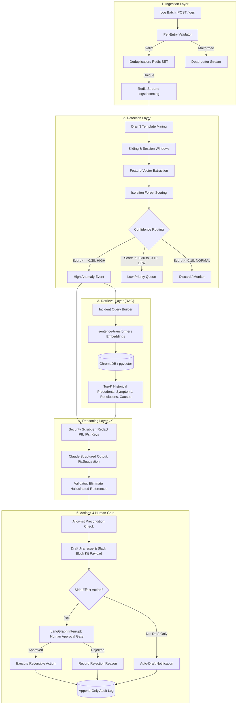

# AIOps Assistant: System Design & Architecture Document

## 1. Overview & Vision

**AIOps Assistant** is an AI decision-support platform designed to solve alert fatigue for DevOps and SRE teams. Rather than emitting bare alerts or attempting risky autonomous fixes, the system:
1. Detects log anomalies early using unsupervised statistical models.
2. Extracts key log templates and correlates them with historically resolved incidents via vector search (RAG).
3. Synthesizes a structured, typed root-cause analysis and remediation proposal using LLM reasoning (Claude).
4. Enforces an explicit action allowlist and requires **human approval** for anything that modifies state or has side effects.
5. Captures every trigger, inference, and human choice into an immutable, append-only audit trail.

---

## 2. Architecture & Data Flow

---

## 3. Key Design Decisions & Trade-Offs

### 3.1 One Anomaly Model (Isolation Forest) vs Complex Deep Learning
* **Decision:** We implemented a single, robust **Isolation Forest** on windowed template frequencies rather than deep LSTM or Autoencoder models.
* **Rationale:**
  - Fast, unsupervised, and runs reliably on standard CPU hardware without GPU overhead.
  - Transparent feature importances: operators can inspect which template counts triggered the anomaly.
  - High resilience to noisy log streams. Complex sequence models (LSTMs, Transformers) require massive labelled anomaly corpora to train effectively, are prone to overfitting, and introduce significant inference latency.

### 3.2 Confidence Bands Instead of Binary Flags
* **Decision:** Raw decision function scores map into three discrete bands:
  - **HIGH** ($\le -0.30$): Triggers full RAG retrieval, Claude synthesis, and on-call alerting.
  - **LOW** ($-0.30 < \text{score} \le -0.10$): Created as low-priority tickets for asynchronous review; automated pages and interrupts are skipped.
  - **NORMAL** ($> -0.10$): Ignored as expected background variance.
* **Rationale:** Binary thresholds cause alert fatigue or missed outages. Confidence bands allow tuning precision for active paging while maintaining visibility into low-confidence anomalies.

### 3.3 Chunking Incidents by Section in the Vector Store
* **Decision:** Rather than embedding full incident postmortems as monolithic documents, incidents are split into structured chunks: `symptoms`, `resolution`, and `root_cause`.
* **Rationale:** When an anomaly first occurs, only symptoms and templates are visible. Querying against dedicated `symptoms` chunks yields higher cosine similarity than querying against resolutions.

### 3.4 Strict Security Scrubbing Before LLM Calls
* **Decision:** Every log snippet and operational context passes through `Scrubber` before being sent to Claude.
* **Rationale:** Log entries routinely contain IP addresses, bearer tokens, passwords, AWS access keys, and PII. Sending unscrubbed logs to external LLMs violates compliance (SOC2, GDPR, HIPAA) and creates credential leak vulnerabilities.

### 3.5 Action Allowlist & The Human Approval Gate
* **Decision:** Fix suggestions cannot execute arbitrary shell commands or arbitrary API calls. All actions must belong to a fixed `ActionType` enum (`DRAFT_JIRA_TICKET`, `SEND_SLACK_ALERT`, `RESTART_SERVICE`, `NO_ACTION`). Reversible actions require human sign-off via LangGraph interrupts or API endpoints (`POST /incidents/{id}/approve`).
* **Rationale:** Hallucinated commands or uncontrolled automation can trigger cascading outages. AIOps Assistant is explicitly a **decision-support copilot**, not an unattended root actor.

---

## 4. Deliberately Excluded (Out of Scope for v1)

1. **Autonomous Destructive Actions:** No automated config wipes, volume unmounts, or unreviewed deployments.
2. **Kafka / Fluentd / Kubernetes Operators:** Redis Streams provides lightweight queuing with consumer groups and zero infrastructure overhead for v1.
3. **Multi-tenant Auth & Billing:** Out of scope for core SRE reliability tooling.

---

## 5. Observability & Self-Monitoring

The system exports standard Prometheus metrics on `GET /metrics`:
- **Ingestion:** `aiops_logs_ingested_total` (labels: `service`, `status`), `aiops_ingestion_batch_size`, `aiops_dlq_entries_total`.
- **Detection:** `aiops_detection_latency_seconds`, `aiops_anomaly_events_total` (labels: `band`), `aiops_drift_detected_total`.
- **Retrieval:** `aiops_retrieval_latency_seconds`, `aiops_retrieval_results_count`.
- **Reasoning:** `aiops_llm_request_latency_seconds`, `aiops_llm_tokens_total`, `aiops_llm_validation_failures_total`.
- **Decisions:** `aiops_incident_approvals_total` (labels: `action`, `decision`).

A complete, pre-configured Grafana dashboard is supplied in `deploy/grafana/dashboards/aiops.json`.
